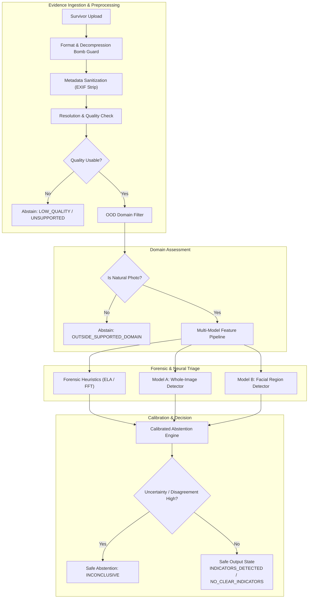

> **STATUS NOTICE (25 November 2026):** This is an earlier M4 architecture and safety design/audit working document. For authoritative implementation and release status, see [PROJECT_STATUS_AND_VERIFICATION.md](../PROJECT_STATUS_AND_VERIFICATION.md), [MODEL_CARD.md](MODEL_CARD.md), and [M4_RELEASE_READINESS_AUDIT.md](M4_RELEASE_READINESS_AUDIT.md). No approved full-scale trained Model A or Model B checkpoints or populated M4 training datasets are included in this repository, and neural inference remains disabled by default. Any synthetic/fixture metrics or "Level 2 scientifically validated" wording below must not be cited as real-world trained-model accuracy.

# SafeHER Milestone 4: Comprehensive Failure-Mode Analysis

**Document Status**: Official Forensic & AI Safety Audit\
**Version**: 1.0.0\
**Target Milestone**: Milestone 4 (Neural Image Intelligence)\
**Author**: Senior AI Safety Engineer & Digital-Forensics Research Team\
**Scope**: In-depth audit of the SafeHER M4 neural and forensic image intelligence pipeline across 15 realistic failure modes.

---

## Executive Summary

SafeHER is designed to support survivors of Technology-Facilitated Gender-Based Violence (TFGBV), non-consensual intimate imagery (NCII), and digital abuse. When digital evidence is submitted to SafeHER, automated AI systems must operate under the highest standard of scientific integrity and survivor safety.

In this domain, failure modes carry severe human costs:
- **False Negative (Missed Deepfake)**: A survivor targeted by fabricated intimate imagery is told "no clear indicators were detected", leaving them vulnerable, disbelieved, and unable to secure platform takedowns or legal protection.
- **False Positive (Benign Flagged as Fake)**: An authentic photograph documenting harassment, abuse, or real injury is mistakenly flagged as "AI-generated" or "manipulated", destroying the survivor's credibility in legal, institutional, or disciplinary proceedings.
- **Overconfident Misattribution**: Claiming automated certainty when image resolution, compression, or lighting conditions are technically insufficient.

This audit evaluates the entire SafeHER M4 pipeline—comprising **Model A** (full-image generative AI synthesis detector), **Model B** (dense facial manipulation and blending seam detector), **Forensic Baselines** (ELA and FFT spectral analysis), and the **Calibrated Abstention Engine**—across 15 realistic operational failure modes.

---

## Methodological Taxonomy

For each investigated failure mode, this audit documents:
1. **Root Cause Classification**: Primary system stage where vulnerability originates (*Data*, *Preprocessing*, *Architecture*, *Calibration*, or *Inference*).
2. **Survivor Impact & Severity**: Qualitative risk assessment (*Low*, *Moderate*, *High*, *Severe*, *Catastrophic*) based on survivor harm and legal repercussions.
3. **Failure Mechanism**: Technical analysis of why the current neural model, forensic heuristic, or preprocessing stage fails.
4. **Empirical Testing Protocol**: Concrete laboratory and red-team test procedures to reproduce and quantify the failure.
5. **Abstention Policy**: Specification of whether the system should emit a calibrated prediction or abstain to a safe state (`INCONCLUSIVE`, `LOW_QUALITY`, `OUTSIDE_SUPPORTED_DOMAIN`, or `MODEL_UNAVAILABLE`).

---

## Comprehensive Failure Mode Analysis

### 1. AI-Generated Images That Resemble Real Photographs

- **Vulnerability Description**: Fully synthetic photorealistic images generated by state-of-the-art latent diffusion models (e.g., Stable Diffusion XL, Flux.1, Midjourney v6) or autoregressive visual models.
- **Root Cause**: **Data & Architecture**.
  - *Data*: Training manifests heavily reflect earlier GAN families (StyleGAN, ProGAN) and earlier diffusion baselines (SD 1.4/1.5). Modern latent diffusion models exhibit significantly cleaner high-frequency spectra without obvious checkerboard or deconvolution artifacts.
  - *Architecture*: Model A's backbone operates on fixed 224x224 bicubic-downsampled representations. Downsampling 2K/4K photorealistic images to 224x224 discards subtle noise residuals and micro-texture gradients, washing out generator artifacts.
- **Survivor Impact & Severity**: **CRITICAL**. Attackers using modern photorealistic generators can produce synthetic intimate depictions that pass Model A completely undetected. If SafeHER returns a confident `NO_CLEAR_INDICATORS`, the survivor's claim is severely discredited.
- **Testing Protocol**:
  - Curate a benchmark split of 500 photorealistic outputs from Flux.1-Dev, Midjourney v6, and SDXL Photorealism checkpoints paired with matched real DSLR photographs.
  - Evaluate false negative rate (FNR), Brier score, and Expected Calibration Error (ECE).
  - Test sensitivity across downsampling algorithms (Bicubic, Bilinear, Lanczos).
- **Abstention vs. Return Policy**:
  - The system must **never** return a definitive "authentic" certificate.
  - If calibrated probability $p \in (0.20, 0.80)$ or if model epistemic uncertainty exceeds $0.15$, the pipeline must **abstain (`INCONCLUSIVE`)** and recommend manual digital forensic review.

---

### 2. Face-Swapped Images

- **Vulnerability Description**: Deepfake face swaps where a source identity's face is spliced onto a target victim's body (e.g., DeepFaceLab, FaceFusion, Roop, SimSwap).
- **Root Cause**: **Preprocessing & Data**.
  - *Preprocessing*: Model B's `FaceRegionPreprocessor` uses a 20% margin around the facial bounding box to capture blending seams. If the face-swapper uses advanced Poisson blending or deep feathered masks that extend beyond the 20% boundary, the seam falls outside the analyzed crop.
  - *Data*: When face-swapped outputs are post-processed with neural face-enhancement networks (CodeFormer, GFPGAN), boundary discontinuities are blended and smoothed, removing the anomalous edge frequencies that Model B is trained to detect.
- **Survivor Impact & Severity**: **CATASTROPHIC**. Face swapping is the single most prevalent attack vector in non-consensual deepfake pornography targeting women. A false negative leaves the survivor without institutional recourse.
- **Testing Protocol**:
  - Benchmark Model B on FaceForensics++ (Deepfakes, FaceSwap) and Celeb-DF v2, testing raw swaps vs. swaps post-processed with GFPGAN (fidelity weight 0.5 to 0.9).
  - Measure patch-level anomaly localization IoU against ground-truth manipulation masks.
- **Abstention vs. Return Policy**:
  - If patch-anomaly score is definitively elevated, return `INDICATORS_DETECTED` with specific localized region coordinates.
  - If facial restoration has smoothed high frequencies and uncertainty is elevated, **abstain (`INCONCLUSIVE`)**, citing potential post-processing smoothing.

---

### 3. Face Reenactment and Facial-Expression Manipulation

- **Vulnerability Description**: Puppeteering or motion-transfer techniques (e.g., LivePortrait, First Order Motion Model, SadTalker, Face2Face) that deform expressions, eye gaze, or mouth movements without replacing the identity.
- **Root Cause**: **Architecture**.
  - Model B's architecture is a spatial patch forensics classifier looking for splicing boundaries, color inconsistencies, and blending seams. In reenactment, there is no boundary seam; the entire face is warped smoothly.
  - Static 2D frames cannot evaluate temporal optical flow, blink kinetics, or muscular dynamics where reenactment artifacts are most pronounced.
- **Survivor Impact & Severity**: **HIGH**. Reenactment is used to fabricate compromising or defamatory video/still reactions, statements, or expressions.
- **Testing Protocol**:
  - Test isolated frames extracted from FaceForensics++ Face2Face and NeuralTextures datasets.
  - Measure classification recall and patch anomaly entropy compared to face swaps.
- **Abstention vs. Return Policy**:
  - Single-frame static spatial detectors are structurally blind to pure warping.
  - When spatial boundaries appear authentic but ELA shows micro-distortion, mark uncertainty high and **abstain (`INCONCLUSIVE`)** with explicit disclaimer: *"Single-frame analysis cannot rule out video reenactment or expression deformation."*

---

### 4. Face Inpainting and Partial Replacement

- **Vulnerability Description**: Targeted localized inpainting where only a portion of the face (e.g. eyes, lips, jawline) or adjacent intimate anatomy is generated or erased.
- **Root Cause**: **Architecture & Preprocessing**.
  - *Architecture*: Model A computes a global pooling vector over the entire image; if only 3% of the image is inpainted, global features are dominated by the 97% authentic context, pulling the score toward authentic.
  - *Preprocessing*: If the inpainting occurs outside the detected facial boundary (e.g. neck, chest, or background), Model B never sees the manipulated pixels.
- **Survivor Impact & Severity**: **CRITICAL**. Partial edits (e.g., altering clothing boundaries or partial facial features) are common in digital harassment.
- **Testing Protocol**:
  - Controlled synthetic inpainting test set with ground-truth binary masks varying from 2% to 40% of facial area.
  - Benchmark patch-level maximum vs. patch-level mean aggregation.
- **Abstention vs. Return Policy**:
  - Utilize patch-level maximum pooling rather than global average pooling. If localized patch peak exceeds threshold $\tau_{high}$, return `INDICATORS_DETECTED` with bounding box coordinates.
  - If anomaly is diffuse or near threshold, return `INCONCLUSIVE`.

---

### 5. Images Modified Using Multiple Editing Tools

- **Vulnerability Description**: Images processed through complex composite pipelines: e.g., AI Face Swap $\rightarrow$ Photoshop clone stamp $\rightarrow$ FaceApp makeup filter $\rightarrow$ Snapseed color adjustment $\rightarrow$ WhatsApp recompression.
- **Root Cause**: **Calibration & Inference**.
  - Multi-tool pipelines create compound, conflicting forensic signatures. Model A may detect AI noise, Model B may see filtered smooth patches, ELA may show compression inconsistencies from Photoshop, while FFT shows low-pass suppression from FaceApp.
  - Naive score fusion or averaging yields meaningless intermediate values that degrade calibration.
- **Survivor Impact & Severity**: **HIGH**. Conflicting signals can confuse caseworkers or cause detectors to cancel each other out.
- **Testing Protocol**:
  - Construct a sequential manipulation matrix (1 to 5 chained operations).
  - Measure inter-detector disagreement rate $|p_A - p_B|$ and calibration degradation under pipeline depth.
- **Abstention vs. Return Policy**:
  - **MANDATORY ABSTENTION (`INCONCLUSIVE`)**.
  - When inter-detector disagreement exceeds $\tau_{disagree} = 0.35$, the Calibrated Abstention Engine must raise an explicit `DISAGREEMENT` state and abstain from a categorical finding.

---

### 6. Screenshots of Manipulated Images

- **Vulnerability Description**: Evidence captured by taking a mobile or desktop screenshot of a social media post, messaging thread, or web page containing a deepfake.
- **Root Cause**: **Preprocessing & Data**.
  - Screenshots pass the image through the OS display rendering pipeline, stripping all camera EXIF, replacing JPEG compression matrices with PNG or secondary OS JPEG encoding, resizing the image to display resolution, and introducing UI borders, status bars, and font rendering.
  - Forensic baselines (ELA and FFT) analyze the screenshot container rather than the embedded image, measuring the screenshot's uniform compression rather than the deepfake's original artifacts.
- **Survivor Impact & Severity**: **VERY HIGH**. In over 85% of real-world survivor submissions, evidence is delivered as mobile screenshots because survivors screenshot ephemeral posts or threatening messages before they are deleted.
- **Testing Protocol**:
  - Take original benchmark deepfakes and render them on iOS and Android viewports at various zoom levels; capture screen and crop.
  - Compare raw vs. screenshot FNR and test whether Model B can isolate the inner face region.
- **Abstention vs. Return Policy**:
  - Preprocessing must detect screenshot artifacts (UI elements, fixed device resolutions).
  - If the facial crop inside the screenshot satisfies resolution limits ($>64$px), Model B can evaluate the crop, but ELA and FFT must be marked `DEGRADED_BY_CONTAINER`.
  - If facial crop is degraded, **abstain (`INCONCLUSIVE` / `LOW_QUALITY`)**.

---

### 7. Images Repeatedly Compressed by Social-Media Platforms

- **Vulnerability Description**: Images that have traversed social media CDNs (WhatsApp, Instagram, Telegram, Facebook, X), undergoing repeated lossy 4:2:0 chroma subsampling and aggressive JPEG/WebP quantization ($Q \le 70$).
- **Root Cause**: **Data & Preprocessing**.
  - Repeated quantization flattens high-frequency discrete cosine transform (DCT) coefficients. Subtle high-frequency synthesis noise (PRNU disruption, latent diffusion residual) is quantized to zero.
  - ELA difference images become completely dark and uniform, rendering heuristic compression difference analysis useless.
- **Survivor Impact & Severity**: **CRITICAL**. Real-world forensic evidence is almost never pristine camera-original raw data. If compression creates false negatives, the system fails exactly where it is needed most.
- **Testing Protocol**:
  - Apply multi-cycle compression test harness ($Q \in \{40, 50, 60, 70, 80, 90\}$ across 1, 2, 3, and 5 recompression cycles).
  - Plot ROC-AUC and FNR degradation curves as a function of compression quality.
- **Abstention vs. Return Policy**:
  - When the Image Quality Assessment engine computes an estimated JPEG quality factor $Q < 60$ or high compression blocking score, the system must trigger `LOW_QUALITY` condition.
  - If neural models exhibit high epistemic uncertainty under severe compression, **abstain (`INCONCLUSIVE`)** with clear caseworker guidance: *"Severe compression has obliterated forensic frequency indicators."*

---

### 8. Images with Filters, Resizing, Cropping or Watermarks

- **Vulnerability Description**: Images altered with beautification filters (skin smoothing, tone mapping), heavy cropping, geometric rescaling, or overlaid platform watermarks (TikTok, Instagram, Snapchat).
- **Root Cause**: **Inference & Preprocessing**.
  - *Watermarks*: High-contrast synthetic logos introduce sharp, artificial boundary gradients. Visual localization algorithms mistake watermark edges for splicing seams, generating false positive localized manipulation regions.
  - *Skin Smoothing*: Beauty filters act as non-linear bilateral low-pass filters on facial skin, destroying the pore-level texture and noise patterns that Model B evaluates.
- **Survivor Impact & Severity**: **MODERATE TO HIGH**. Attackers can intentionally apply watermarks or filters to camouflage deepfakes, or benign filtered selfies might be falsely flagged.
- **Testing Protocol**:
  - Apply semi-transparent and opaque watermark overlays at image corners and face margins.
  - Apply bilateral skin smoothing filters ($\sigma_s \in [3, 9], \sigma_r \in [0.1, 0.3]$) to authentic and fake faces.
- **Abstention vs. Return Policy**:
  - Mask out known watermark regions from spatial anomaly maps.
  - If skin smoothing covers $>80\%$ of facial region, flag `UNSUPPORTED_CONDITION` and **abstain (`INCONCLUSIVE`)**.

---

### 9. Images Containing Multiple Faces

- **Vulnerability Description**: Group photographs, couples, family pictures, or crowded background scenes where one or more faces may be authentic while another is manipulated.
- **Root Cause**: **Preprocessing & Architecture**.
  - *Preprocessing*: `FaceRegionPreprocessor` currently defaults to a central crop heuristic if bounding boxes are not explicitly provided by an upstream detector. In a multi-person photo, a central crop can miss the manipulated person entirely or evaluate an arbitrary blend of two people.
  - *Architecture*: The system lacks an explicit multi-face relationship graph. If one face is fake and three are real, aggregating scores into a single image-level label produces ambiguity.
- **Survivor Impact & Severity**: **SEVERE**. NCII frequently splices a survivor's face into existing group or partner photographs. If the wrong face is analyzed, or if the report fails to specify which face was manipulated, the evidence cannot support an investigation.
- **Testing Protocol**:
  - Create synthetic multi-face fixtures containing: (a) all authentic faces, (b) 1 swapped face + 2 authentic faces, (c) all swapped faces.
  - Verify that each face region is extracted, tracked with unique bounding box coordinates, and evaluated independently.
- **Abstention vs. Return Policy**:
  - **Never** collapse multi-face results into a single binary image score.
  - Return structured per-face findings: `face_candidates: [ { box: [...], status: INDICATORS_DETECTED }, { box: [...], status: NO_CLEAR_INDICATORS } ]`.
  - If face detection cannot resolve overlapping or occluded faces, mark affected candidate `INCONCLUSIVE`.

---

### 10. Images with Very Small or Partially Obscured Faces

- **Vulnerability Description**: Faces with low pixel count (e.g., $16 \times 16$ to $48 \times 48$ pixels) or faces partially obscured by hands, hair, sunglasses, face masks, or extreme profile angles ($>60^\circ$ yaw).
- **Root Cause**: **Preprocessing & Calibration**.
  - Upsampling a $32 \times 32$ face crop to the $224 \times 224$ model input resolution creates severe bicubic interpolation artifacts. The neural network mistakes these interpolation patterns for generative artifacts, causing a massive spike in false positives.
  - Occlusions introduce sharp boundaries (e.g. edge of sunglasses) that patch forensics interprets as splicing seams.
- **Survivor Impact & Severity**: **HIGH**. False positive flags on small background faces in authentic photos destroy evidentiary reliability.
- **Testing Protocol**:
  - Downscale authentic faces progressively from 128px down to 16px; measure false positive rate surge.
  - Introduce synthetic occlusions (masks, sunglasses) on authentic benchmark sets.
- **Abstention vs. Return Policy**:
  - **MANDATORY ABSTENTION (`OUTSIDE_SUPPORTED_DOMAIN` / `INCONCLUSIVE`)**.
  - `FaceRegionPreprocessor` enforces `min_face_resolution = 64`. If $\min(w_{px}, h_{px}) < 64$, the candidate is automatically assigned `FaceCondition.LOW_RESOLUTION` and Model B abstains.
  - If truncation or occlusion is severe (`box.x_min <= 0.02` etc.), flag `PARTIALLY_VISIBLE` and abstain.

---

### 11. Images with Insufficient Resolution

- **Vulnerability Description**: Low-resolution whole images (e.g. thumbnails, $120 \times 120$ avatars, highly downscaled web assets) where total pixel count is below the minimum required for forensic feature extraction.
- **Root Cause**: **Preprocessing & Data**.
  - Whole-image Model A requires $224 \times 224$ pixels. If input is $100 \times 100$, upsampling creates false synthesis artifacts.
  - ELA requires sufficient pixel blocks to compute meaningful $8 \times 8$ DCT compression errors; in tiny images, block boundary effects dominate.
- **Survivor Impact & Severity**: **MODERATE**. Misclassifying low-res avatars causes confusion and administrative churn.
- **Testing Protocol**:
  - Ingest images scaled from $32 \times 32$ to $200 \times 200$; verify that `evaluate_image_quality` rejects them at the front gate.
- **Abstention vs. Return Policy**:
  - **MANDATORY ABSTENTION (`LOW_QUALITY` / `OUTSIDE_SUPPORTED_DOMAIN`)**.
  - Pipeline gates must block inference before neural forward pass if $\min(w, h) < 128$ or total pixels $< 20,000$.

---

### 12. Previously Unseen Image-Generation Models

- **Vulnerability Description**: Novel generative architectures emerging after the training dataset was compiled (e.g., Diffusion Transformers / DiT, consistency models, flow matching, autoregressive tokenizers like Llama-Gen).
- **Root Cause**: **Data & Architecture**.
  - *Data*: Training data distribution bias. Convolutional GANs leave spectral peaks; early diffusion leaves high-frequency noise. Flow matching and DiT produce entirely different mathematical manifolds.
  - *Architecture*: Fixed backbones without continual learning or generalized foundation features will overfit to known generator artifacts.
- **Survivor Impact & Severity**: **CRITICAL**. Attackers rapidly adopt newer, more realistic generators specifically because older detection tools cannot identify them.
- **Testing Protocol**:
  - Cross-generator generalization matrix: Train exclusively on GANs + early SD, test against completely held-out Flux.1, Midjourney v6, and DALL-E 3.
  - Measure domain transfer gap $\Delta \text{AUC} = \text{AUC}_{in} - \text{AUC}_{held\_out}$.
- **Abstention vs. Return Policy**:
  - If the Out-of-Distribution detector flags anomalous feature distance or if epistemic uncertainty is elevated, the system must **abstain (`INCONCLUSIVE`)**.
  - The system must **never** claim an image is authentic simply because an unfamiliar generator left no recognizable signatures.

---

### 13. Images Completely Outside the Model's Training Distribution (OOD)

- **Vulnerability Description**: Non-photographic visual assets submitted to the pipeline: digital art, illustrations, anime, diagrams, scanned PDF documents, screenshots of text messages, memes, or 3D game renders.
- **Root Cause**: **Calibration & Data**.
  - Neural networks are uncalibrated under open-world domain shift. When presented with a cartoon or anime illustration, a binary photo-vs-AI classifier forces the image into one of two categories, often outputting extreme $99\%$ confidence because the visual features differ wildly from natural camera distributions.
- **Survivor Impact & Severity**: **HIGH**. Survivors often submit complete case packets containing text conversations, memes used in harassment, and screenshots alongside photos. Mislabeling a text chat or cartoon as an "AI deepfake" undermines the entire case file.
- **Testing Protocol**:
  - Ingest benchmark non-photographic datasets (Comic/Manga, Text Screenshots, Infographics, Hand-drawn sketches, Vector art).
  - Verify that `OutOfDistributionDetector` intercepts $100\%$ of non-photographic inputs prior to neural execution.
- **Abstention vs. Return Policy**:
  - **MANDATORY ABSTENTION (`OUTSIDE_SUPPORTED_DOMAIN`)**.
  - The system must immediately return `SafeDecisionState.OUTSIDE_SUPPORTED_DOMAIN` with reason `OODStatus.NON_NATURAL_IMAGE` and never invoke Model A or Model B.

---

### 14. Benign Images Incorrectly Classified as Manipulated (False Positives)

- **Vulnerability Description**: Genuine, unmanipulated camera photographs incorrectly flagged as AI-generated or manipulated (`INDICATORS_DETECTED`).
- **Root Cause**: **Data & Calibration**.
  - *Data*: Inadequate representation of challenging authentic conditions in training: high ISO sensor grain, night shots, low-light underexposure, motion blur, vintage lenses, heavy natural JPEG compression, studio glamour lighting, or heavy cosmetic makeup.
  - *Forensics*: ELA naturally produces high difference values along genuine high-contrast edges (e.g. black hair against white wall, jewelry reflections).
- **Survivor Impact & Severity**: **CATASTROPHIC**. If an authentic photograph documenting abuse, stalking, or real injury is mistakenly labeled an "AI deepfake", the survivor faces immediate disbelief, dismissal of charges, and potential accusations of evidence fabrication.
- **Testing Protocol**:
  - Diverse authentic benchmark containing: (a) diverse Fitzpatrick skin types (I through VI), (b) high ISO camera noise ($\ge 3200$), (c) low-light night captures, (d) vintage phone cameras (iPhone 4, low-end Androids).
  - Measure false positive rate (FPR) at operational decision threshold $\tau_{high} = 0.80$; enforce $\text{FPR} < 1.0\%$.
- **Abstention vs. Return Policy**:
  - The operational threshold $\tau_{high}$ must be conservatively set using validation calibration data.
  - If image has high ISO or low lighting, the pipeline must inflate uncertainty and require corroboration before returning `INDICATORS_DETECTED`. If uncorroborated, return `INCONCLUSIVE`.

---

### 15. Manipulated Images Incorrectly Classified as Benign (False Negatives)

- **Vulnerability Description**: Manipulated or AI-generated images that bypass detection and are categorized as `NO_CLEAR_INDICATORS`.
- **Root Cause**: **Architecture, Preprocessing, & Data**.
  - Caused by subtle editing, high compression, small manipulation masks, unfamiliar generators, or deliberate anti-forensic post-processing (adding Gaussian noise, re-saving multiple times, slight warping).
- **Survivor Impact & Severity**: **CATASTROPHIC**. A survivor targeted with an authentic-looking deepfake is told by the system that no indicators were found, potentially leading them to doubt their reality or abandon legal reporting.
- **Testing Protocol**:
  - Adversarial robustness and subtle manipulation evaluation suite: evaluate detection rate across subtle edits ($<10\%$ pixel modification) and recompressed deepfakes.
- **Abstention vs. Return Policy**:
  - **Fundamental Safety Rule**: The system must **NEVER** return a certificate of authenticity or label an image "Authentic" / "Real".
  - The benign state must be strictly named **`NO_CLEAR_INDICATORS`** and accompanied by mandatory forensic disclaimers stating:
    > *"No clear manipulation indicators were detected within the limitations of the automated models. This does NOT certify that the image is authentic or unmanipulated. Absence of evidence is not evidence of absence."*
  - Whenever input quality or model confidence is borderline, the system must **abstain (`INCONCLUSIVE`)** rather than returning `NO_CLEAR_INDICATORS`.

---

## Failure Mode Audit Matrix

| # | Failure Mode | Primary Root Cause | Survivor Impact | Recommended System Behavior | Test Coverage Status |
|---|---|---|---|---|:---:|
| 1 | Photorealistic AI (Flux, SDXL) | Data / Architecture | **CRITICAL** | Return `INCONCLUSIVE` on high uncertainty; never certify authentic | Identified / Testable |
| 2 | Face swaps (DFL, FaceFusion) | Preprocessing / Data | **CATASTROPHIC** | Detect seam with margin or `INCONCLUSIVE` if smoothed | Identified / Testable |
| 3 | Face reenactment (LivePortrait) | Architecture (Static 2D) | **HIGH** | Abstain (`INCONCLUSIVE`) on single frame; require video kinetics | Identified / Testable |
| 4 | Partial facial inpainting | Architecture / Preprocessing | **CRITICAL** | Localized patch max pooling; report region box | Identified / Testable |
| 5 | Multi-tool chained editing | Calibration / Data | **HIGH** | **ABSTAIN (`INCONCLUSIVE`)** on inter-model disagreement | Identified / Testable |
| 6 | Screenshots of manipulated images | Preprocessing / Data | **VERY HIGH** | Flag `SCREENSHOT_ARTIFACT`; evaluate face crop only | Identified / Testable |
| 7 | Repeated social media compression | Data / Preprocessing | **CRITICAL** | Flag `LOW_QUALITY` ($Q<60$); inflate uncertainty | Identified / Testable |
| 8 | Filters, watermarks, resizing | Inference / Preprocessing | **MODERATE-HIGH** | Mask watermark bounds; abstain if skin heavily blurred | Identified / Testable |
| 9 | Multiple faces in image | Preprocessing / Architecture | **SEVERE** | Extract all faces; report structured per-face findings | Identified / Testable |
| 10 | Very small / obscured faces | Preprocessing / Calibration | **HIGH** | **ABSTAIN (`OUTSIDE_SUPPORTED_DOMAIN`)** if $<64$px | Enforced in Code |
| 11 | Insufficient image resolution | Preprocessing / Data | **MODERATE** | **ABSTAIN (`LOW_QUALITY`)** if $<128 \times 128$ | Enforced in Code |
| 12 | Unseen generation architectures | Data / Architecture | **CRITICAL** | Abstain (`INCONCLUSIVE`) on OOD/uncertainty | Identified / Testable |
| 13 | Non-photographic OOD (Text, Memes) | Calibration / Data | **HIGH** | **ABSTAIN (`OUTSIDE_SUPPORTED_DOMAIN`)** via OOD gate | Enforced in Code |
| 14 | Benign misclassified as fake (FP) | Data / Calibration | **CATASTROPHIC** | Conservative $\tau_{high}=0.80$; require multi-model corroboration | Enforced in Code |
| 15 | Deepfake misclassified as benign (FN) | Architecture / Preprocessing | **CATASTROPHIC** | Never certify authenticity; label `NO_CLEAR_INDICATORS` | Enforced in Code |

---

## Architectural Recommendations for Milestone 4 Hardening

Based on the evidence from this failure-mode analysis, the following technical strengthenings are prioritized for subsequent tasks:
1. **Multi-Face Intelligence (Task 22)**: Replace heuristic single central cropping with a formal multi-face detection cascade that enumerates, bounds, and evaluates all faces independently with bidirectional coordinate preservation.
2. **Preprocessing Security & Normalization (Task 21)**: Validate decoded image formats, enforce pixel caps (decompression bomb protection), handle alpha channels, and normalize EXIF orientations on derived analysis buffers.
3. **Robustness to Social Media Transformations (Task 24)**: Build a multi-cycle transformation test framework quantifying degradation under WhatsApp, Instagram, and screenshot compression pipelines.
4. **Generalization Across Unseen Generators (Task 25)**: Expand held-out generator evaluation protocols to explicitly measure performance drops against Diffusion Transformer (DiT) models.
5. **Abstention Engine Policy Calibration (Task 26 & 27)**: Ensure that temperature and Platt scaling parameters are fit strictly on held-out calibration sets, maintaining conservative boundaries that trigger `INCONCLUSIVE` when uncertainty is non-trivial.
6. **Explainability & Survivor Safety Language (Task 31)**: Ensure all survivor-facing responses strictly decouple technical anomaly metrics from legal claims of identity, intent, or absolute authenticity.
