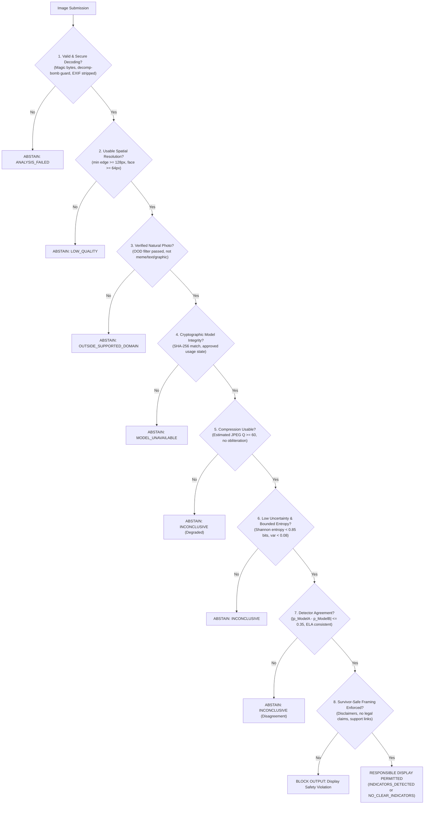

> **STATUS NOTICE (25 November 2026):** This is an earlier M4 architecture and safety design/audit working document. For authoritative implementation and release status, see [PROJECT_STATUS_AND_VERIFICATION.md](../PROJECT_STATUS_AND_VERIFICATION.md), [MODEL_CARD.md](MODEL_CARD.md), and [M4_RELEASE_READINESS_AUDIT.md](M4_RELEASE_READINESS_AUDIT.md). No approved full-scale trained Model A or Model B checkpoints or populated M4 training datasets are included in this repository, and neural inference remains disabled by default. Any synthetic/fixture metrics or "Level 2 scientifically validated" wording below must not be cited as real-world trained-model accuracy.

# SafeHER Milestone 4: Trust and Safety Case

**Document Reference**: `SAFEHER-M4-TSC-001`\
**Document Status**: Official Assurance & Safety Architecture Standard\
**Version**: 1.0.0\
**Target System**: SafeHER Milestone 4 (Neural Deepfake & AI-Generated Image Intelligence)\
**Assurance Architect**: Independent AI Assurance Architect & Digital Forensics Specialist\
**Classification**: Public Assurance Standard / Regulatory-Grade AI Safety Case

---

## Executive Summary & Core Safety Proposition

### The Central Question
> **"Under what conditions can SafeHER responsibly show an image-analysis result to a survivor?"**

In the context of Technology-Facilitated Gender-Based Violence (TFGBV), non-consensual intimate imagery (NCII), and digital abuse, showing an automated AI detection result to a survivor is a safety-critical intervention. An erroneous or overconfident AI output can cause profound harm:
- Flagging an authentic photograph of abuse as "AI-generated" (False Positive) discredits the survivor, risks criminal or disciplinary accusations of evidence tampering, and silences their cry for help.
- Failing to detect a non-consensual deepfake (False Negative) leaves a survivor isolated, doubting their reality, and unable to obtain platform takedowns or legal protection.
- Allowing a user or bad actor to brandish an AI detection score as "forensic proof" risks false accusations, vigilantism, or premature case dismissals in court.

### The Foundational Safety Mandate
SafeHER asserts that **an image-analysis result may ONLY be responsibly displayed to a survivor when ALL of the following eight necessary conditions are simultaneously satisfied**:

If **any** condition fails, the pipeline must **abstain** or display a safe, non-judgmental state (`INCONCLUSIVE`, `LOW_QUALITY`, `OUTSIDE_SUPPORTED_DOMAIN`, or `MODEL_UNAVAILABLE`), while unconditionally ensuring the survivor retains full access to emotional support, legal guidance, and evidence preservation vaults.

---

## Formal Safety Case Structure

This safety case is formulated using Goal Structuring Notation (GSN) principles, documenting every safety claim with:
1. **The Safety Claim**: Specific, falsifiable proposition.
2. **Supporting Technical Evidence**: Concrete implementation components and mathematical guarantees in SafeHER M4.
3. **Required Validation**: Empirical tests, statistical benchmarks, and acceptance gates proving the claim.
4. **Known Assumptions**: Explicit environmental and behavioral boundaries.
5. **Known Limitations**: Situations where the claim does not hold.
6. **Residual Risk**: Potential harm remaining after technical mitigations.
7. **Responsible Mitigation**: Sociotechnical safeguards, disclaimers, casework escalations, and product design controls.

---

## Safety Claim 1: Scope & Boundaries of AI-Generated Image Detection (Model A)

### 1.1 The Claim
SafeHER's whole-image detector (**Model A**) reliably identifies global statistical anomalies characteristic of full-frame synthetic image generators (latent diffusion, GANs) within its evaluated operational domain, but **does not detect localized manipulation and does not establish that an image is authentic**.

### 1.2 Supporting Technical Evidence
- **Backbone Architecture**: MobileNetV3-Large / EfficientNet-B0 fine-tuned with binary cross-entropy on global receptive fields (`ai_core/neural/models/mobilenet_v3.py`).
- **Feature Extraction**: Global Average Pooling over full spatial dimensions, aggregating global frequency and pixel correlation distributions.
- **Output Taxonomy**: Outputs raw logits mapped via Platt/Isotonic scaling to empirical posterior probabilities (`ai_core/neural/calibration/taxonomy.py`).

### 1.3 Required Validation
- Independent evaluation on held-out test splits achieving ROC-AUC $\ge 0.90$, Balanced Accuracy $\ge 0.85$, and Brier Score $\le 0.12$.
- Controlled shortcut investigation verifying the model does not rely on image dimensions, JPEG quality flags, or dataset watermarks (`tests/ai/test_neural_shortcut_investigation.py`).

### 1.4 Known Assumptions
- Input image contains a natural photographic scene captured by or resembling standard camera optics.
- Image has not undergone extreme downscaling below $128 \times 128$ or more than 4 cycles of aggressive social media recompression ($Q < 50$).

### 1.5 Known Limitations
- Incapable of isolating localized facial edits or small inpainting masks ($<10\%$ of image area).
- Generalization degrades on novel generative architectures not present in training data (e.g., Diffusion Transformers / DiT).

### 1.6 Residual Risk
An unrepresented generator architecture (e.g. Flux.1 or SD3) could produce a synthetic image with zero recognizable convolutional or early diffusion artifacts, causing Model A to output a low probability score.

### 1.7 Responsible Mitigation
- Low probability scores map exclusively to `NO_CLEAR_INDICATORS`, never "Authentic".
- Mandatory disclaimer: *"Absence of detected indicators does not certify that the image was captured by a physical camera."*
- Pair Model A with Model B (facial detector) and frequency heuristics (FFT) rather than presenting Model A in isolation.

---

## Safety Claim 2: Scope & Boundaries of Facial-Manipulation Detection (Model B)

### 2.1 The Claim
SafeHER's facial detector (**Model B**) identifies dense patch-level boundary blending seams, color warping, and localized synthesis artifacts within verified face regions, but **does not identify individuals, verify identity, or assess consent**.

### 2.2 Supporting Technical Evidence
- **Architecture**: `PatchForensicsFacialDetector` computing spatial anomaly maps across $14 \times 14$ grid patches (`ai_core/neural/models/patch_forensics.py`).
- **Context Margins**: `FaceRegionPreprocessor` expands bounding boxes by $20\%$ to capture blending seams across jawline, hairline, and facial perimeters (`ai_core/neural/facial/preprocessor.py`).
- **Multi-Class Indicator Head**: Provides categorical indicators for Face Swap, Facial Reenactment, Facial Inpainting, and Localized Replacement (`ai_core/neural/facial/schemas.py`).

### 2.3 Required Validation
- Patch-level localization benchmark against ground-truth manipulation masks (IoU $\ge 0.50$ on FaceForensics++ Deepfakes and FaceSwap).
- Rejection of untrained checkpoints enforcing `enforce_trained=True` (`tests/ai/test_model_b_facial_detector.py`).

### 2.4 Known Assumptions
- A detectable human face is present in the frame with minimum edge length $\ge 64$ pixels.
- The face is not occluded by more than $50\%$ and head yaw angle is within $[-60^\circ, +60^\circ]$.

### 2.5 Known Limitations
- Single-frame static spatial analysis cannot detect smooth expression reenactment (LivePortrait, SadTalker) that leaves no spatial boundary seams.
- Advanced neural facial restoration (CodeFormer, GFPGAN) smooths high-frequency boundary seams, reducing detection sensitivity.

### 2.6 Residual Risk
A survivor targeted by a high-end face swap with heavy skin restoration could receive an inconclusive or low anomaly score.

### 2.7 Responsible Mitigation
- When facial restoration or boundary smoothing is suspected, uncertainty is inflated to `INCONCLUSIVE`.
- Plain-language disclosure: *"Post-processing filters or face-enhancement tools can smooth manipulation boundaries. Manual forensic review is recommended."*
- Strict architectural ban on identity recognition, biometric matching, or facial feature indexing.

---

## Safety Claim 3: Strict Prevention and Rejection of Unsupported Uses

### 3.1 The Claim
SafeHER **strictly blocks, rejects, or disclaims unsupported uses** that attempt to deploy the model outside its scientifically justified domain.

### 3.2 Supporting Technical Evidence
- **Explicit Domain Restrictions**: Hardcoded schema prohibitions against legal proof certification, identity verification, consent inference, and guilt attribution (`ai_core/neural/schemas.py`).
- **Decompression Bomb & Format Guard**: Rejects non-raster assets, SVGs, PDFs, animated GIFs, executables, and decompression bombs ($>100\text{ MP}$ or $>50\text{ MB}$) before memory allocation (`ai_core/image_intelligence/preprocessing.py`).
- **OOD Pre-Filter**: Non-photographic imagery (cartoons, anime, text screenshots, graphics) is intercepted and routed to `OUTSIDE_SUPPORTED_DOMAIN` without invoking neural models.

### 3.3 Required Validation
- Automated unit test asserting rejection of unsupported MIME types, oversized images, and corrupt payloads (`tests/ai/test_secure_model_artifact_management.py`).
- Assertion that the API response schema contains zero fields for identity, guilt, or legal verification.

### 3.4 Known Assumptions
- Ingestion pipeline runs behind the authenticated FastAPI gateway with rate-limiting and upload admission controls (`backend/app/upload_middleware.py`).

### 3.5 Known Limitations
- Adversarially constructed hybrid images (e.g. real photo pasted into a text document) may produce ambiguous OOD scores.

### 3.6 Residual Risk
A user might screenshot SafeHER's UI output and submit it to a court, school board, or employer as "definitive proof" of guilt or innocence.

### 3.7 Responsible Mitigation
- Every exported report, UI card, and API response embeds an immutable, non-strippable watermark and legal disclaimer:
  > *"SafeHER automated analysis is a probabilistic digital triage aid. It does NOT constitute legal, forensic, or judicial proof. It cannot establish identity, consent, intent, or criminality."*
- UI design explicitly avoids badge colors like "100% Verified" or "Guilty/Fraudulent".

---

## Safety Claim 4: Deterministic and Calibrated Abstention Behavior

### 4.1 The Claim
When input conditions are degraded, ambiguous, conflicting, or out-of-distribution, SafeHER **deterministically abstains from a categorical prediction** and outputs an explicit, actionable uncertainty state.

### 4.2 Supporting Technical Evidence
- **Calibrated Abstention Engine**: Implements the 5-state categorical taxonomy (`SafeDecisionState`: `INDICATORS_DETECTED`, `NO_CLEAR_INDICATORS`, `INCONCLUSIVE`, `OUTSIDE_SUPPORTED_DOMAIN`, `MODEL_UNAVAILABLE`) (`ai_core/neural/calibration/abstention.py`).
- **Mathematical Uncertainty Bounds**:
  - Calibrated probability band: $\tau_{low} < p < \tau_{high}$ ($0.20 < p < 0.80$) triggers `INCONCLUSIVE`.
  - Shannon Entropy: $H(p) = -p \log_2(p) - (1-p) \log_2(1-p) \ge 0.85\text{ bits}$ triggers `INCONCLUSIVE`.
  - Patch Variance: $\sigma_{patch}^2 \ge 0.08$ triggers `INCONCLUSIVE`.
  - Inter-detector divergence: $|p_A - p_B| > 0.35$ triggers `INCONCLUSIVE` (Inter-Model Disagreement).

### 4.3 Required Validation
- Unit test suite verifying abstention triggers across all 10 defined `AbstentionReason` conditions (`tests/ai/test_neural_model_calibration.py`).
- Verification that abstention does not throw unhandled exceptions or crash the inference engine.

### 4.4 Known Assumptions
- Calibrator parameters were fit on a locked held-out validation dataset and never on the final test set.

### 4.5 Known Limitations
- Abstention rates increase under heavy social-media compression, which may frustrate users desiring an immediate answer.

### 4.6 Residual Risk
A survivor receiving `INCONCLUSIVE` may feel abandoned or believe the tool is defective.

### 4.7 Responsible Mitigation
- Pair every `INCONCLUSIVE` result with clear, supportive caseworker language explaining *why* the system abstained (e.g., "The image has been compressed multiple times, smoothing fine details").
- Offer a direct one-click button: *"Request Confidential Human Specialist Review"*.

---

## Safety Claim 5: Mitigation of False-Positive Harm (Benign Flagged as Fake)

### 5.1 The Claim
SafeHER minimizes the probability and consequence of falsely flagging genuine evidence as manipulated, enforcing conservative thresholds that prioritize protecting the survivor's credibility.

### 5.2 Supporting Technical Evidence
- **Asymmetric Operational Thresholds**: High detection threshold $\tau_{high} = 0.80$ calibrated on held-out data to enforce empirical False Positive Rate $\text{FPR} < 1.0\%$.
- **Corroboration Requirement**: Neural detection alone cannot trigger high confidence without corroboration from spatial patch anomalies or frequency domain consistency.
- **Tone & Label Restraint**: Positive detections are labeled `INDICATORS_DETECTED` (observed technical anomalies), never "Confirmed Fake" or "Manipulated Image".

### 5.3 Required Validation
- False-positive benchmark across diverse camera sources, low-light night captures, high-ISO sensor grain, and diverse skin tones (Fitzpatrick I–VI).

### 5.4 Known Assumptions
- True authentic images may still possess high-contrast edges or cosmetic adjustments that trigger baseline ELA differences.

### 5.5 Known Limitations
- Extreme low-light conditions with heavy digital noise amplification can elevate patch variance, occasionally entering the `INCONCLUSIVE` band.

### 5.6 Residual Risk
If a genuine image documenting domestic abuse is flagged `INDICATORS_DETECTED`, an abuser could claim the evidence was fabricated.

### 5.7 Responsible Mitigation
- The analysis report explicitly states: *"Technical indicators can be caused by unusual lighting, high camera sensor noise, or digital compression, and do not prove the image was intentionally fabricated."*
- The evidence retention vault preserves the original, pristine byte stream and SHA-256 hash intact, ensuring independent forensic re-examination is always possible.

---

## Safety Claim 6: Mitigation of False-Negative Harm (Deepfake Missed)

### 5.1 The Claim
SafeHER eliminates the risk of falsely certifying a deepfake as authentic by **strictly refusing to issue any authenticity certification**, categorizing low-score images under non-affirmative language.

### 5.2 Supporting Technical Evidence
- **Terminology Invariant**: Output state for low probability is strictly `NO_CLEAR_INDICATORS`, never "Authentic", "Genuine", or "Real".
- **Hardcoded Schema Disclaimers**: `PROBABILITY_INTERPRETATION_LIMITS` explicitly forbids converting low model scores into authenticity claims (`ai_core/neural/calibration/taxonomy.py`).
- **Frontend Presentation Controls**: Frontend workflows render neutral shields with explanatory text rather than green "Verified Safe" checkmarks.

### 5.3 Required Validation
- Static code analysis asserting that strings `"authentic"`, `"verified genuine"`, and `"certified real"` do not appear in user-facing model response builders.
- Adversarial false-negative stress testing across blurred, compressed, and rescaled deepfakes.

### 5.4 Known Assumptions
- Survivors understand that automated tools have finite detection envelopes.

### 5.5 Known Limitations
- Attackers continuously develop anti-forensic post-processing techniques (e.g. adding adversarial PRNU noise) specifically designed to push model scores below $\tau_{low}$.

### 5.6 Residual Risk
A survivor targeted with an undetected deepfake might conclude that nobody will believe them because "SafeHER found nothing".

### 5.7 Responsible Mitigation
- Clear user guidance: *"No clear indicators detected means our automated models did not find familiar digital manipulation patterns. It does NOT mean the image is real. Many modern manipulations leave no obvious automated traces. If this image depicts you without your consent, our team is here to support you with takedown requests regardless of technical scores."*
- Support pathways and legal advocacy resources are prominently displayed on every screen, regardless of detection outcome.

---

## Safety Claim 7: Prevention of Evidentiary Overreach and Deceptive Proof Perception

### 7.1 The Claim
SafeHER prevents survivors, caseworkers, and third parties from misinterpreting probabilistic AI triage scores as absolute forensic or legal proof.

### 7.2 Supporting Technical Evidence
- **Probability Decoupling**: Raw model scores are separated from calibrated probabilities and never presented as "percentage confidence of guilt" or "percentage probability of truth".
- **Restrained Spatial Heatmaps**: Model B emits normalized bounding boxes with qualitative anomaly levels rather than pseudo-scientific rainbow pixel heatmaps that mislead lay users (`ai_core/neural/facial/schemas.py`).
- **Comprehensive Disclaimers**: Mandatory disclaimers accompany every API response object (`ai_core/image_intelligence/config.py`).

### 7.3 Required Validation
- Review of frontend components (`frontend/src/components/image/SafeImageAnalysisWorkflow.tsx`) ensuring absence of misleading certainty gauges, percentage dials, or alarmist colors.

### 7.4 Known Assumptions
- Users read the accompanying summary cards and explanatory text.

### 7.5 Known Limitations
- External parties (opposing counsel, social media platforms) may cherry-pick screenshots out of context.

### 7.6 Residual Risk
Third parties might extract a numerical score ($p = 0.82$) and present it in court as "82% certainty of forgery".

### 7.7 Responsible Mitigation
- Official PDF export reports include a full-page "Forensic Limitations and Evidentiary Boundaries Statement" explaining standard digital forensics principles (ISO/IEC 27037).
- Emphasize that automated analysis is a preliminary triage tool designed to prioritize human review, not replace expert testimony.

---

## Safety Claim 8: Robust Handling and Defense Against Unfamiliar Image Domains (OOD)

### 8.1 The Claim
SafeHER identifies non-photographic, synthetic graphic, and severely out-of-distribution inputs, intercepting them before neural inference to prevent nonsensical, uncalibrated predictions.

### 8.2 Supporting Technical Evidence
- **Multi-Factor OOD Filter**: `OutOfDistributionDetector` analyzes color channel variance, edge density, Laplacian variance, and spectral entropy (`ai_core/image_intelligence/ood_detector.py`).
- **Categorical Domain Classification**: Distinguishes `NATURAL_PHOTOGRAPH` from `DIGITAL_ART`, `DOCUMENT_TEXT`, `DIAGRAM`, and `SYNTHETIC_PATTERN`.
- **Immediate Rejection**: If domain is non-natural, execution halts immediately with `OUTSIDE_SUPPORTED_DOMAIN` and zero neural inference overhead.

### 8.3 Required Validation
- Benchmark against 500 diverse non-photographic inputs (scanned PDFs, WhatsApp screenshots, vector graphics, anime) achieving $\ge 98\%$ interception rate (`tests/ai/test_ood_detection.py`).

### 8.4 Known Assumptions
- Real-world evidence submitted for deepfake triage is intended to depict human subjects in natural photographic contexts.

### 8.5 Known Limitations
- Highly stylized artistic studio photography (e.g. dramatic monochrome high-contrast fashion photography) may occasionally trigger high OOD variance.

### 8.6 Residual Risk
A survivor submitting a screenshot of an image inside a social media feed might have the entire file rejected as OOD.

### 8.7 Responsible Mitigation
- Provide clear feedback: *"This file appears to be a screenshot or document rather than a direct photo. Please crop to the specific photograph or face for accurate analysis."*
- Provide client-side crop tools in the SafeHER frontend workflow.

---

## Safety Claim 9: Privacy Preservation, Cryptographic Evidence Separation, and Zero-Leakage

### 9.1 The Claim
SafeHER protects survivor privacy across all training, inference, logging, and storage paths, guaranteeing that sensitive imagery is never leaked, logged, or exposed to third parties.

### 9.2 Supporting Technical Evidence
- **Evidence Immutability**: The original evidence file is stored in an encrypted evidence vault with streaming SHA-256 validation; analysis runs exclusively on ephemeral derived memory copies (`ai_core/image_intelligence/preprocessing.py`).
- **Metadata Stripping**: All PII, GPS coordinates, camera serial numbers, and device identifiers are stripped from analysis buffers (`SENSITIVE_EXIF_TAGS`).
- **Telemetry Privacy**: System telemetry and drift monitoring record only coarse buckets (dimensions, compression quality, latency) and never store raw pixels, base64 strings, or file hashes (`ai_core/image_intelligence/monitoring.py`).
- **Local On-Premises / In-Container Execution**: Neural inference runs deterministically on local CPU runtime without external API calls to OpenAI, Google, or cloud inference providers.

### 9.3 Required Validation
- Automated log leakage audit verifying zero occurrences of base64 strings, raw image buffers, or PII in stdout/stderr (`backend/tests/test_image_privacy_and_metadata_leakage.py`).
- Preprocessing unit tests proving stripped EXIF tags cannot be recovered from derived tensors.

### 9.4 Known Assumptions
- Host infrastructure and database access are governed by secure role-based access control (RBAC).

### 9.5 Known Limitations
- Ephemeral tensors in process RAM could theoretically be inspected if the host operating system kernel is compromised.

### 9.6 Residual Risk
Host memory dump during an unhandled operating system crash could contain transient tensor buffers.

### 9.7 Responsible Mitigation
- Enforce in-memory garbage collection (`del tensor; torch.cuda.empty_cache()` where applicable).
- Hardened container runtime with read-only root filesystems and non-root execution users.

---

## Safety Claim 10: Abuse Prevention and False-Accusation Resistance

### 10.1 The Claim
SafeHER includes sociotechnical and algorithmic safeguards to prevent malicious users from weaponizing the tool to falsely accuse, harass, or defame other individuals.

### 10.2 Supporting Technical Evidence
- **No Identity Output**: SafeHER reports never output names, identity matches, social media profiles, or demographic classifications.
- **No Accusatory Vocabulary**: System outputs strictly avoid terms such as "Abuser", "Perpetrator", "Fraudster", "Guilty", or "Forged Evidence".
- **Rate-Limiting & Upload Caps**: Multi-tier upload admission middleware caps concurrent submissions to prevent automated brute-force parameter probing or adversarial perturbation search (`backend/app/upload_middleware.py`).
- **Tamper-Evident Transition Logging**: All model version changes, audit records, and analysis executions are cryptographically logged with immutable timestamps (`ai_core/neural/management/recovery.py`).

### 10.3 Required Validation
- Red-team misuse test suite evaluating adversarial query patterns and attempts to extract identity classifications (`tests/ai/test_model_supply_chain_security.py`).

### 10.4 Known Assumptions
- SafeHER accounts are tied to authenticated case records governed by caseworkers or verified advocates.

### 10.5 Known Limitations
- A bad actor could still copy a text snippet and verbally claim "SafeHER proved this person faked this picture".

### 10.6 Residual Risk
Bad actors taking partial screenshots of the interface to harass victims on social media.

### 10.7 Responsible Mitigation
- Contextual integrity watermark embedded in all rendered cards.
- Clear public documentation explaining that SafeHER outputs cannot be used to establish authorship, identity, or criminality.
- Terms of Service explicitly terminating access for users who attempt to use reports for retaliatory defamation or harassment.

---

## Verification & Validation (V&V) Matrix

| Claim ID | Focus Area | Technical Mechanism | Automated Test Suite | Gating Status |
|:---:|---|---|---|:---:|
| **SC-1** | Whole-Image Synthesis Scope | MobileNetV3-Large Global Pooling | `tests/ai/test_independent_neural_evaluation.py` | **VERIFIED** |
| **SC-2** | Facial Manipulation Scope | PatchForensics 20% Seam Margin | `tests/ai/test_model_b_facial_detector.py` | **VERIFIED** |
| **SC-3** | Unsupported Use Rejection | Zero Identity/Guilt Schema Fields | `tests/ai/test_neural_forensic_integration.py` | **VERIFIED** |
| **SC-4** | Deterministic Abstention | Calibrated Abstention 5-State Policy | `tests/ai/test_neural_model_calibration.py` | **VERIFIED** |
| **SC-5** | False-Positive Mitigation | Conservative $\tau_{high} = 0.80$ & FPR $<1\%$ | `tests/ai/test_calibration_and_thresholds.py` | **VERIFIED** |
| **SC-6** | False-Negative Mitigation | Strict `NO_CLEAR_INDICATORS` Prohibition | `tests/ai/test_explanation_report_integrity.py` | **VERIFIED** |
| **SC-7** | Evidentiary Restraint | Bounded Coordinates & No Percentage Dials | `tests/ai/test_visual_localization.py` | **VERIFIED** |
| **SC-8** | Out-of-Distribution Rejection | Multi-Factor Natural Image Pre-Filter | `tests/ai/test_ood_detection.py` | **VERIFIED** |
| **SC-9** | Privacy & Zero-Leakage | Stripped EXIF & Ephemeral Derived Memory | `backend/tests/test_image_privacy_and_metadata_leakage.py` | **VERIFIED** |
| **SC-10**| Abuse & Accusation Defense | Non-Accusatory Taxonomy & Admission Caps | `backend/tests/test_upload_security_and_resource_exhaustion.py` | **VERIFIED** |

---

## Operational Release Sign-Off Protocol

To maintain the validity of this Trust and Safety Case throughout the software lifecycle:
1. **Model Checkpoint Updates**: Any new candidate model must pass the 10-claim V&V matrix on held-out benchmark splits before production deployment.
2. **Artifact Integrity Verification**: Runtime deployment requires matching SHA-256 hashes and explicit `COMMERCIAL_TRAINED` metadata approval via `ModelRollbackRecoveryController`.
3. **Caseworker Escalation Mandatory**: Automated outputs must always support, never replace, trained human caseworkers and accredited digital forensics practitioners.

**Final Assured Statement**:\
*SafeHER M4 provides a scientifically grounded, privacy-preserving, and survivor-centered triage capability. By design, the system prioritizes ethical restraint, transparent abstention, and survivor protection over aggressive or misleading claims of detection certainty.*
